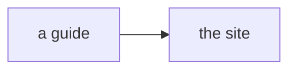

# Diagrams and images

A guide shows a diagram or an image the way GitHub expects: a Mermaid fence, or an image with a path relative to the guide. bearings keeps both working on the site, and checks them.

## Mermaid diagrams

Write a diagram as a fenced code block with the language `mermaid`. Mermaid is text, so an agent can write it and read it back, a change to it is an ordinary diff, and GitHub draws it in place:

````markdown

````

On the site, the fence becomes a `pre` with the class `mermaid`, holding the diagram's source, escaped as HTML:

```html
<pre class="mermaid">flowchart LR
  accTitle: From guide to site
  guide[&quot;a guide&quot;] --&gt; site[&quot;the site&quot;]
</pre>
```

The markdown copy keeps the fence as written, so an agent reads the source.

### Drawing them in the browser

Turning the source into a picture is the layout's job, which keeps bearings free of Node and of any one Mermaid version. A layout loads Mermaid on the pages that need it, which `page.diagrams?` tells it:

```erb
<%- if page.diagrams? -%>
<script type="module">
  import mermaid from "https://cdn.jsdelivr.net/npm/mermaid@11/dist/mermaid.esm.min.mjs";
  mermaid.initialize({ startOnLoad: true });
</script>
<%- end -%>
```

Mermaid finds every `pre class="mermaid"` on the page and draws it. [Getting started](GETTING_STARTED.md#how-a-build-runs) has a diagram drawn this way.

### What is checked

`rake docs:check` reports a diagram that is empty, one whose first line names no Mermaid diagram type, and one with no `accTitle:` line. The `accTitle` is the diagram's alt text: what a screen reader announces in place of the picture. Add an `accDescr:` line too when the title alone doesn't say what the diagram shows.

The check doesn't run Mermaid, so a mistake further into a diagram is not reported: look at the page in `rake docs:serve` after changing one.

## Images

Show an image with markdown, or with an HTML `img`, or a `picture` whose `source`s give other versions. Its path is relative to the guide, as GitHub reads it:

```markdown

```

That line, in this guide, shows this:


For every image a guide shows, bearings:

- copies the file into the site under `/assets/`, at its path from the repo root, so `docs/images/bearings.svg` is served at `/assets/docs/images/bearings.svg`;
- points the page's `src` or `srcset` at that copy;
- adds `width` and `height`, read from the file, to an `img` that sets neither, so the page doesn't shift as it loads (it reads them from PNG, GIF and JPEG files, and from an SVG's `width` and `height` or its `viewBox`);
- adds `loading="lazy"` to an `img` that doesn't set `loading`;
- points the markdown copy at the image's full URL under `site.url`, so the copy shows it when read on its own.

An image path that starts with `/` or names another site is left as it is.

Keep images next to the guides, in a folder the manifest [watches](MANIFEST.md#watch), so the check can tell you when one is no longer used.

### What is checked

`rake docs:check` reports an image with no alt text, one that is not there, one larger than the manifest's `checks.image_limit_kb` (300 KB unless you set it), and one in a watched folder that no guide shows. Alt text is all an agent or a screen reader gets, so write it as a description of what the image shows, not as its name.

An image loaded from another site is a warning: it breaks when you read the guides offline, and it can change or vanish without a diff. [The checks](CHECKS.md#image) lists every image problem.
