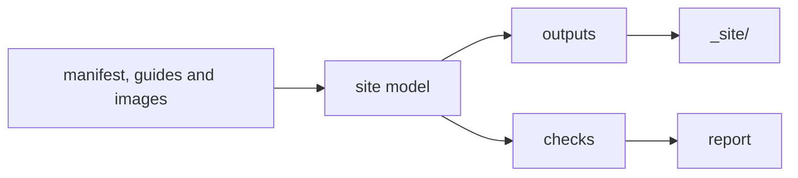

# Getting started

bearings turns a folder of plain markdown guides into a static site. You write the guides, list them in a manifest, and write a layout that gives the site its look. bearings builds the pages, a markdown copy of every guide, `llms.txt`, a search index and a sitemap, and checks that the links, anchors, code examples, constant names, images and diagrams in them are all sound.

It has no theme. The layout is yours: an ERB template your repo keeps beside the manifest.

## Install

bearings needs Ruby 3.3 or later. Add it to your `Gemfile`, with `rake`, which runs its tasks:

```ruby
group :development do
  gem 'bearings'
  gem 'rake'
  # Only for the constant check, which compares the guides with your RBS signatures.
  gem 'rbs'
end
```

bearings' own dependencies are kramdown, kramdown-parser-gfm, rouge and zeitwerk. It never needs Node or another program.

## The two Rakefile lines

```ruby
require 'bearings/rake'
Bearings::Rake.install
```

That adds four tasks:

| Task                       | What it does                                                                                |
| -------------------------- | ------------------------------------------------------------------------------------------- |
| `rake docs`                | Builds the site into `_site/`                                                               |
| `rake docs:check`          | Builds the site and runs every check, failing on any error                                  |
| `rake docs:serve`          | Builds the site, serves it at `http://localhost:8000` and rebuilds it when its files change |
| `rake docs:check:external` | Requests every external link in the guides and reports the ones that fail                   |

`docs`, `docs:check` and `docs:check:external` print the problems they found, and exit with status 1 if any is an error. Set `FORMAT=json` to print them as JSON instead; [The checks](/guides/checks.md#reading-a-report) shows both forms.

The manifest is `docs-site/manifest.yml` unless you pass another path. The layout, the landing page and the site's other files are read from the manifest's folder, whatever it is called:

```ruby
Bearings::Rake.install(manifest: 'site/manifest.yml')
```

Code blocks are highlighted with Rouge, and a Rouge lexer your Rakefile loads before the build highlights the blocks in its language. To highlight a language with your own lexer for this build only, pass `lexers:`, which maps a fence language to a `Rouge::Lexer` subclass:

```ruby
Bearings::Rake.install(lexers: { 'ruby' => MyRubyLexer, 'rbs' => MyRbsLexer })
```

A block uses the mapped lexer when Rouge reads its language as the mapped one, so `'ruby'` covers `rb` fences too, and a language Rouge doesn't know at all is highlighted when the mapping names it. Rouge's own lexers stay registered as they were, so nothing else in the process changes, and the markdown copies and `llms.txt` keep the guides' source. `install` raises an `ArgumentError` for a value that isn't a `Rouge::Lexer` subclass. Define your lexer without a `tag` that Rouge already uses, since `tag` registers it with Rouge for every caller.

Every task runs from the repo root, and the ones that build write to `_site/` there, so add `_site/` to your `.gitignore`.

## A first site

A site needs a guide, a manifest that lists it, a layout and a landing page:

```text
docs/GETTING_STARTED.md
docs-site/manifest.yml
docs-site/layout.html.erb
docs-site/index.html.erb
```

The guide is plain markdown. Its first `# ` line is the page title:

```markdown
# Getting started

Install the gem, then run it.
```

The manifest names the site and lists every page, each with the guide it comes from, the slug its URL is built from, and a one-line description:

```yaml
site:
  name: My gem
  url: https://docs.example.com

watch:
  - docs

groups:
  - label: Start here
    pages:
      - source: docs/GETTING_STARTED.md
        slug: getting-started
        description: Install the gem and run it
```

The layout renders each guide. This one is about as small as a layout can be:

```erb
<!doctype html>
<html lang="en">
  <head>
    <meta charset="utf-8">
    <title><%= page.title %> · <%= site.name %></title>
  </head>
  <body>
    <main><%= body %></main>
  </body>
</html>
```

The landing page becomes `/index.html`. It gets the site and its pages, but no single page:

```erb
<!doctype html>
<html lang="en">
  <head>
    <meta charset="utf-8">
    <title><%= site.name %></title>
  </head>
  <body>
    <%- pages.each do |page| -%>
    <p><a href="<%= page.url %>"><%= page.title %></a>: <%= page.description %></p>
    <%- end -%>
  </body>
</html>
```

Then build and check it:

```sh
bundle exec rake docs:check
```

The guide is now at `_site/guides/getting-started/index.html`, with its markdown copy at `_site/guides/getting-started.md`. Run `bundle exec rake docs:serve` and open `http://localhost:8000` to read it.

> [!NOTE]
> The guide is still a plain markdown file that GitHub renders on its own. Nothing in it is written for bearings: no front matter, no shortcodes, no syntax GitHub would show as text. Relative links between guides, relative image paths, alert blocks like this one and Mermaid diagrams all read the same in both places.

## How a build runs

Each build starts the same way. The manifest and the guides it lists become one site model; each output turns that model into files, and each check turns it into problems.



A run reports every problem it finds, not only the first. `rake docs` and `rake docs:check` write `_site/` even when they report errors, so you can look at what is wrong; they write nothing only when the manifest itself can't be read, or two outputs would write the same file. `rake docs:serve` is the exception: a rebuild with an error keeps serving the last good site.

Each build replaces `_site/`: a file the build no longer writes is deleted, so keep nothing of your own in it.

## Where to next

- [The manifest](/guides/manifest.md): every key it takes
- [The layout](/guides/layout.md): what your templates are given
- [Diagrams and images](/guides/diagrams-and-images.md): drawing and showing things in a guide
- [The outputs](/guides/outputs.md) and [The checks](/guides/checks.md): everything a build writes and reports
